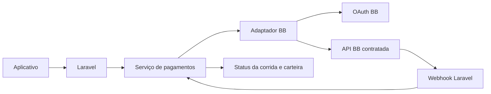

# Integração com APIs do Banco do Brasil

Este diretório descreve como integrar o backend Laravel às APIs do Banco do Brasil (BB) pelo Portal Developers. Ele cobre o que é comum ao portal e mantém separados os detalhes que dependem da API contratada, como Pix, cobrança, boleto, conta, transferência ou Login BB.

> **Objetivo do projeto:** a API do Banco do Brasil substituirá o AbacatePay como provedor de pagamentos. Até a conclusão da migração, o AbacatePay continua sendo o provedor ativo em produção e desenvolvimento.

## Escopo e fonte de verdade

O endereço [APIs do Portal Developers BB](https://apoio.developers.bb.com.br/apis) é um catálogo. A especificação de rotas, escopos, parâmetros, contrato de webhook e requisitos de certificado pertencem ao **OpenAPI da API específica** escolhida e habilitada na aplicação BB.

Por isso, este repositório não presume que uma rota de cobrança ou Pix esteja disponível. Antes de implementar, baixe o OpenAPI do produto escolhido no portal e guarde uma cópia revisada em `docs/integracoes/banco-do-brasil/especificacoes/`, sem credenciais.

| Documento | Conteúdo |
| --- | --- |
| [configuracao.md](configuracao.md) | Credenciais, variáveis de ambiente e clientes HTTP. |
| [oauth-e-seguranca.md](oauth-e-seguranca.md) | Fluxos OAuth2, token, callback e proteção de segredos. |
| [integracao-pagamentos.md](integracao-pagamentos.md) | Mapeamento para as cobranças Pix/cartão já existentes no backend. |
| [operacao-e-validacao.md](operacao-e-validacao.md) | Sandbox, webhooks, observabilidade e checklist de produção. |
| [exemplos.http](exemplos.http) | Exemplos HTTP com placeholders seguros. |

## Situação atual do backend

O projeto usa `AbacatePayClient`, `CobrancaPixService`, `CobrancaCartaoService` e `PagamentoCorridaService` para pagamentos. Não existe ainda cliente ou credencial do BB no código.

A substituição do AbacatePay pelo BB deve ficar atrás de uma interface de provedor de pagamento. Dessa forma, os controllers e regras de corrida não precisam conhecer OAuth, `gw-app-key`, certificado ou formatos externos.

## Pré-requisitos no Portal BB

1. Criar ou selecionar a aplicação no Portal Developers BB.
2. Assinar ou solicitar acesso à API desejada.
3. Gerar credenciais do ambiente de teste.
4. Salvar com segurança `developer_application_key`, `client_id` e `client_secret`. O portal informa que as credenciais são exibidas uma única vez e uma nova geração invalida as anteriores.
5. Baixar o documento OpenAPI do produto e identificar:
   - escopos OAuth;
   - grant OAuth exigido;
   - URLs de sandbox e produção;
   - cabeçalhos obrigatórios;
   - necessidade de mTLS/certificado;
   - contrato, autenticação e tentativas de webhook;
   - idempotência, consulta, cancelamento e estorno.
6. Cadastrar as URLs de callback ou webhook no portal, se o produto exigir.

## Ambientes conhecidos

| Finalidade | URL |
| --- | --- |
| OAuth de teste | `https://oauth.hm.bb.com.br` |
| OAuth de produção | `https://oauth.bb.com.br` |
| Discovery teste | `https://oauth.hm.bb.com.br/oauth/.well-known/openid-configuration` |
| Discovery produção | `https://oauth.bb.com.br/oauth/.well-known/openid-configuration` |

A base da API de negócio não é definida aqui porque é específica do produto e deve vir do OpenAPI baixado do Portal BB.

## Referências oficiais

- [Portal Developers BB: visão geral](https://apoio.developers.bb.com.br/guias-e-tutoriais/introducao/sobre-o-portal-developers)
- [Portal Developers BB: credenciais](https://apoio.developers.bb.com.br/guias-e-tutoriais/primeiros-passos/credenciais)
- [Portal Developers BB: Authorization Code](https://apoio.developers.bb.com.br/guias-e-tutoriais/seguranca/authorization-code)
- [Catálogo de APIs BB](https://apoio.developers.bb.com.br/apis)
