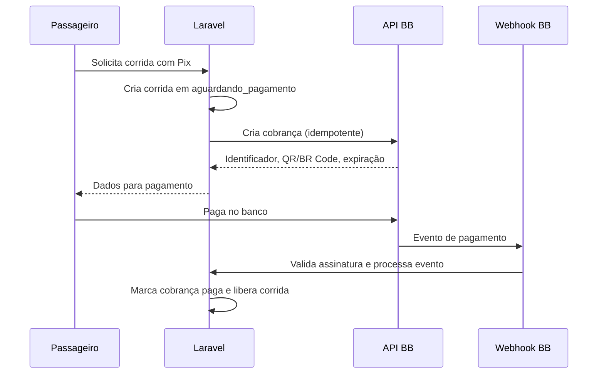

# Integração de pagamentos BB no domínio de corridas

## Objetivo

O Banco do Brasil será a infraestrutura de pagamento que substituirá o AbacatePay. As regras de negócio da corrida — criação, valor, estado, cancelamento, taxa, carteira do motorista e estorno — continuam no domínio Laravel.

O AbacatePay permanece ativo enquanto a integração BB não cobrir criação, consulta, confirmação, expiração, cancelamento e estorno das cobranças utilizadas pelo aplicativo.

## Ponto de integração atual

| Componente atual | Responsabilidade | Evolução recomendada |
| --- | --- | --- |
| `AbacatePayClient` | Comunicação HTTP com o provedor atual | Substituir por `BancoDoBrasilClient` através de um contrato de provedor. |
| `CobrancaPixService` | Gerar/consultar cobrança Pix | Delegar a um contrato `ProvedorPix` implementado pelo BB. |
| `CobrancaCartaoService` | Gerar/consultar checkout de cartão | Manter separado; só substituir se o produto BB suportar cartão. |
| `PagamentoCorridaService` | Confirmar pagamento, estornar e liberar corrida | Não deve depender de SDK/endpoints BB. |
| `WebhookAbacatePayController` | Entrada de eventos do provedor atual | Substituir por controller específico para o webhook BB conforme o contrato da API escolhida. |

## Contrato sugerido

```php
interface ProvedorPix
{
    public function criar(CobrancaPixInput $input): CobrancaPixResultado;

    public function consultar(string $referenciaExterna): CobrancaPixResultado;

    public function cancelarOuEstornar(string $referenciaExterna, int $valorCentavos): void;
}
```

O adaptador BB converte apenas entre o contrato interno e o OpenAPI do produto. Os modelos `CobrancaPix` e `Corrida` mantêm o identificador externo, estado normalizado, valor em centavos, expiração e timestamps.

## Fluxo de cobrança Pix



## Regras que não devem mudar

1. A corrida com Pix ou cartão permanece `aguardando_pagamento` até a confirmação comprovada.
2. Webhook é preferível à consulta periódica; consulta é contingência e reconciliação.
3. O evento deve ser idempotente: o mesmo evento pode ser entregue mais de uma vez.
4. Não creditar motorista antes de a cobrança estar confirmada.
5. Estorno depende do estado local e da confirmação do provedor; não repetir estorno já concluído.
6. Valores devem ser armazenados/trafegados no domínio em centavos quando possível, sem conversão de ponto flutuante para decisão financeira.

## Dados a confirmar no OpenAPI do produto BB

Antes da implementação, preencher esta tabela a partir da especificação baixada.

| Item | Produto BB selecionado | Decisão |
| --- | --- | --- |
| Operação de criação de cobrança | Pendente | Nome, método e path do OpenAPI. |
| QR Code/BR Code | Pendente | Campo de resposta a persistir. |
| Chave de idempotência | Pendente | Header/campo e prazo de retenção. |
| Consulta de status | Pendente | Path, estados e periodicidade. |
| Webhook | Pendente | URL, assinatura, IP/certificado e retries. |
| Cancelamento/estorno | Pendente | Regras e operação correspondente. |
| mTLS | Pendente | Obrigatório ou não; formato do certificado. |
| App key | Pendente | Cabeçalho/query e nome exato. |
| Rate limit | Pendente | Backoff e circuit breaker. |

Não mapeie os estados BB diretamente para os estados de corrida. Crie um mapeamento explícito e coberto por testes.
